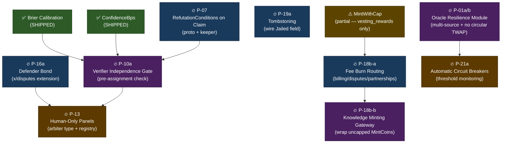

# Implementation Roadmap
## Prioritized Plan with Dependency Graph

**Generated:** 2026-04-28 (Integration Phase — Mission 4 of 9)  
**Authored by:** Beta 🦞 (session 7, autonomous)  
**Depends on:** UNIFIED-TAXONOMY.md (M1), ARCHITECTURE-DIAGRAMS.md (M2), EXISTING-ALIGNMENT-AUDIT.md (M3)

---

## Overview

The research corpus (21 briefs, 2 synthesis docs, 1 audit) has identified 9 Tier-1 gaps in zerone's current implementation. These are organized into 5 foundation missions accepted by Yu. This roadmap sequences those missions, identifies internal dependencies, and partitions the work into build phases so no mission blocks another unnecessarily.

**The guiding constraint:** Start with missions that have no upstream dependencies. End with missions that require the most foundation to be in place. Build in vertical slices (proto → keeper → tests) not horizontal sweeps (all protos, then all keepers).

---

## Dependency Graph

**Reading the graph:**
- Arrows = "enables" (target can start once source is done, or benefits significantly from it)
- Dashed borders = external dependencies (shipped work, not new missions)
- Phase 1 (blue) = no upstream dependencies in the gap inventory
- Phase 2 (purple) = depends on Phase 1
- Phase 3 (brown) = depends on Phase 1 + Phase 2

---

## Primitive Scoring

Each gap scored on three dimensions:
- **Leverage** — how many downstream primitives and briefs reference this gap (1–5)
- **Cost** — changeset size (small = schema only; medium = 1-2 files; large = new module or major surgery)
- **Risk** — state-changing (requires migration or can break existing state)

| Gap | Mission | Leverage | Cost | Risk | Phase |
|-----|---------|----------|------|------|-------|
| P-07 RefutationConditions | unified-claim-proto | ★★★★★ | small | low | 1 |
| P-18b-a Fee burn routing | supply-burn-path | ★★★★☆ | small | low | 1 |
| P-19a Tombstoning | defender-bond (companion) | ★★★☆☆ | small | medium | 1 |
| P-16a Defender bond | defender-bond | ★★★★☆ | medium | medium | 1 |
| P-18b-b Knowledge minting gate | supply-burn-path | ★★★★★ | medium | medium | 2 |
| P-10a Independence pre-check | unified-claim-proto | ★★★★☆ | medium | low | 2 |
| P-01a/b Oracle resilience | oracle-resilience | ★★★★★ | large | medium | 2 |
| P-21a Automatic circuit breakers | circuit-breakers | ★★★★☆ | large | high | 3 |
| P-13 Human-only panels | unified-claim-proto | ★★★☆☆ | large | medium | 3 |

---

## Phase 1 — Foundations (No Upstream Dependencies)

These can be built in any order within the phase. Each is self-contained.

### Mission: Foundation — Supply Burn Path (`foundation-supply-burn-path-maxsupplyuzrn-enforcement`)

**Scope (Phase 1 portion):**
- Part A: Billing burn routing — change `ExecuteDistribution` to call `BurnCoins("uzrn")` on the `ProtocolBurn` amount instead of routing to development_fund. Configurable percentage via governance param (`BurnRateBps`).
- Part A: Disputes burn — in `distributeWin` (`disputes/keeper/keeper.go:600-607`), route the "burn remainder" to actual `BurnCoins` rather than development_fund.
- Part A: Partnerships burn — in `HandleExit` (`partnerships/keeper/exit.go:127-130`), route forfeited amount to `BurnCoins`.
- Emit transparent burn events with amounts for tracking.

**What NOT to do in Phase 1:** Do not touch knowledge module minting paths yet. That's Part B (Phase 2 — requires careful surgery into the largest module).

**Files changed:** `x/billing/keeper/distribution.go`, `x/disputes/keeper/keeper.go`, `x/partnerships/keeper/exit.go`, `x/billing/types/params.go` (add BurnRateBps)  
**Tests:** Verify BurnCoins called with correct amounts, events emitted, development_fund no longer receives "burn" amounts

---

### Mission: Foundation — Defender Bond (`foundation-defender-bond-for-settlement-fairness`)

**Scope:**
Two sub-deliverables — defender bond and tombstoning. Related because both touch `x/disputes` and `x/staking`.

**P-16a Defender bond:**
- Modify `InitiateDispute` to require/notify the defender. Two approaches:
  - Option A (simpler): Defender bond is optional; if defender posts it within evidence period, they're eligible for reward on win; if they don't post and lose, their existing validator stake is slashed.
  - Option B (symmetric): Require defender to match the challenger bond within `DefenderBondDeadline` blocks. If no bond posted, dispute auto-resolves in challenger's favor.
  - **Recommendation: Option B** (symmetric bonding is the research finding's core claim — asymmetric bonding invites bad-faith disputes with known defenders)
- `Dispute` struct gets `DefenderBond string`, `DefenderBondDeadline uint64`, `DefenderBondPosted bool`
- `MsgPostDefenderBond` new message type
- `DistributeSettlement` updated to handle both bond pools

**P-19a Tombstoning (companion to defender bond):**
- Wire `val.Jailed = true` in `SlashValidator` when a new `TombstoneThreshold` is reached (hard limit beyond `MaxSlashCountDeactivate`)
- Jailed validators blocked from: delegation, verification assignment, arbiter selection
- Re-entry path: explicit `MsgUnjailValidator` requiring governance approval AND time elapsed
- Proto: `Jailed bool` is already there — just write it

**Files changed:** `x/disputes/keeper/msg_server.go`, `x/disputes/keeper/keeper.go`, `x/disputes/types/tx.pb.go`, `x/staking/keeper/keeper.go`, `x/staking/types/params.go`  
**Tests:** defender bond posting, bond distribution on win/lose/draw, tombstone slash threshold, unjail flow

---

### Mission: Foundation — Unified Claim+Verification Proto (`foundation-unified-claim-verification-proto-schema`)

**Scope (Phase 1 portion — schema):**
- **P-07 RefutationConditions:** Add `repeated string refutation_conditions = N` to the `Fact` proto (or new `Claim` wrapper). This is the claim-level declaration of what would disprove it. Store alongside the claim, surface in queries, validate non-empty for certain methodology types (M-FALSIFICATIONIST should require it).
- The vocabulary already exists at Methodology level (`FalsificationPaths`) — the claim-level field is an instance of applying those paths to the specific claim being made.
- **Proto change:** `types.proto` → add `RefutationConditions []string` to Fact/Claim type
- **Keeper change:** `msg_server.go` MsgSubmitClaim validates and stores `refutation_conditions`
- **Query change:** `GetFact` response includes `refutation_conditions`
- `ConfidenceBps` is already implemented — confirm wired correctly (Brier mission's output)

**Files changed:** `proto/zerone/knowledge/v1/types.proto`, `x/knowledge/keeper/msg_server.go`, `x/knowledge/types/types.pb.go` (regenerated)  
**Tests:** Submit claim with and without refutation conditions, validate storage, query returns them

---

## Phase 2 — Composed Primitives (Depend on Phase 1)

### Mission (continued): Foundation — Supply Burn Path — Part B

**P-18b-b Knowledge minting gateway:**
- The three uncapped `MintCoins` calls in knowledge:
  - `probe_bounty_pool.go:52` → wrap in supply cap check
  - `msg_server_training_v4.go:224, 336` → wrap in supply cap check
  - `genesis.go:97, 227` → genesis is acceptable (one-time, pre-chain-start)
- Implementation: add `MintWithCap` dependency to knowledge keeper (or inline the cap check)
- Knowledge keeper already has `bankKeeper` — read supply before minting
- Risk: if MaxSupplyUzrn is already near-exhausted, knowledge rewards silently zero out. Need a governance parameter for "knowledge reward floor" that adjusts the economics rather than silently failing.

**Files changed:** `x/knowledge/keeper/probe_bounty_pool.go`, `x/knowledge/keeper/msg_server_training_v4.go`, `x/knowledge/keeper/keeper.go`  
**Tests:** Minting at supply cap → reward is 0 or floored, not panicked; events emitted

---

### Mission (continued): Foundation — Unified Claim+Verification Proto — Part B

**P-10a Verifier independence pre-check:**
- Add pre-assignment gate to round creation in `x/knowledge/keeper/rounds.go`
- Before assigning verifiers to a new round, call `GetValidatorIndependence` for each candidate
- If `ConformityBps > IndependenceExclusionThresholdBps` (new governance param), exclude from this round
- The threshold should be a soft percentile gate (e.g., exclude worst 10% by conformity) not a hard score, to avoid over-restricting the verifier pool
- Requires Phase 1 `RefutationConditions` to be meaningful: independence is measured as "did this verifier disagree with consensus even when presented with a falsification condition?"

**Files changed:** `x/knowledge/keeper/rounds.go`, `x/knowledge/types/params.go` (add IndependenceExclusionThresholdBps)  
**Tests:** Verifier with high conformity excluded from new rounds, remaining pool size sufficient

---

### Mission: Foundation — Oracle Resilience (`foundation-oracle-resilience-module`)

**Two distinct oracle problems:**

**P-01b Multi-source knowledge oracle:**
- New `x/oracle_consensus` module (or extend cmd/oracle to accept multiple evaluator endpoints)
- Each oracle endpoint: registered on-chain with operator stake, reports verdict + confidence
- Aggregation: median across honest reporters, trimmed mean excluding outliers
- Attestable: `OracleReport` type stores who said what when (signed)
- Dispute window: 50 blocks to challenge an oracle report
- Slashing: verifiably false reports slashed via existing `SlashValidator`
- This is a new on-chain module, not an off-chain service change

**P-01a TWAP circular dependency:**
- The circular dependency: billing reads ZRN price from ZRN's own liquidity pool
- Fix: require an external USD/stable price peg as the denominator, not a ZRN pool
- Implementation options:
  - Option A: Add an external oracle feed for ZRN/USD that is not derived from the ZRN AMM (uses the new P-01b multi-source oracle)
  - Option B: Allow the AMM to also track an external reference price alongside its internally-derived TWAP, using it when the internal TWAP moves more than N% in a block (circuit breaker-style)
  - **Recommendation: Option A** — cleaner, avoids bootstrapping problem
- `ManualZrnPriceUsd` governance override remains as a safety escape

**Files:** New `x/oracle_consensus/` module (proto, keeper, msg_server, types); changes to `x/billing/keeper/dynamic_pricing.go`  
**Tests:** Multi-oracle aggregation with honest/dishonest reporters, circular dependency removed, staleness handling

---

## Phase 3 — Orchestration (Depend on Phase 1 + Phase 2)

### Mission: Foundation — Automatic Circuit Breakers (`foundation-automatic-circuit-breakers-for-safety`)

**Dependencies:** Oracle resilience (Phase 2) must be done first. Circuit breakers that monitor TWAP price should use the non-circular price feed, not the current circular one.

**Design:**
Three-tier response: DEGRADED → RESTRICTED → HALTED

**Monitoring metrics (read from existing modules):**
1. **Slash rate anomaly** — slash events per N blocks from `x/staking` exceeds `SlashRateAnomalyBps`
2. **Oracle price deviation** — ZRN/USD moves >X% from N-block TWAP (reads from fixed oracle after Phase 2)
3. **Treasury drawdown** — `treasury_protocol` or `development_fund` balance drops >Y% in Z blocks (reads from bank module)
4. **Transaction volume anomaly** — transaction count per block exceeds Z (reads from `ctx.TxCount()` or equivalent)

**Implementation:**
- New `x/monitor` module with BeginBlocker that checks all four metrics
- On breach: emit event + transition chain state
- DEGRADED: emit warning event, alert via telemetry
- RESTRICTED: pause specific tx types via ante handler extension (MsgSwap, MsgDelegate — not MsgSubmitClaim)
- HALTED: trigger `x/emergency.ProposeHalt` automatically with machine-signed proposal
- Guardian can override any tier downward (manual resume)
- All transitions are transparent: events + audit log entries

**Files:** New `x/monitor/` module; changes to `app/ante.go` for RESTRICTED tier; `x/emergency/` for auto-halt trigger  
**Tests:** Each metric threshold trigger, tier transitions, Guardian override, audit trail completeness

---

### Mission (continued): Foundation — Unified Claim+Verification Proto — Part C

**P-13 Human-only panels:**

**Dependencies:** Defender bond (Phase 1) must be done first. Human validators need a bond pathway similar to defender bonds — to post stake against their human attestation, creating accountability.

**Design:**
- New `HumanValidator` registry: validators can attest to human identity via a governance-approved verification process (DID-based or external verifier)
- `MsgAttestHumanValidator` — submit attestation with verifier reference
- `ArbiterRequirement` type on Disputes: `validator_only | human_only | mixed`
- `SelectArbiters` extended to filter by arbiter requirement type
- Human attestations expire (renewable via re-attestation) — prevents stale human claims

**Files:** New `human_registry.go` in `x/qualification/keeper/`; changes to `x/disputes/keeper/keeper.go` SelectArbiters; `x/disputes/types/types.proto` (ArbiterRequirement)  
**Tests:** Human validator registry, attestation expiry, dispute with human_only requirement selects only attested humans

---

## Build Sequence

Given the dependency graph, the recommended build order within each phase:

### Phase 1 (order within phase — any ordering is valid, this is optimal)
1. `RefutationConditions on Claim` (P-07) — smallest, safest, no risk of breaking tests
2. `Fee burn routing` (P-18b-a) — small routing change, confirms BurnCoins works in test env
3. `Tombstoning` (P-19a) — small, wire existing Jailed field
4. `Defender bond` (P-16a) — moderate, new proto message + settlement logic

### Phase 2 (order within phase)
5. `Knowledge minting gateway` (P-18b-b) — knowledge module internal, no new APIs
6. `Verifier independence gate` (P-10a) — adds gate to existing round creation path
7. `Oracle resilience module` (P-01a/b) — new module, most complex in this phase

### Phase 3 (order within phase)
8. `Human-only panels` (P-13) — extends existing qualification system
9. `Automatic circuit breakers` (P-21a) — new module, requires oracle resilience + existing staking/emergency wiring

---

## What's Not in This Roadmap

These are real gaps from the research but are **Tier 2 or lower** (deliberate omissions for now):

- **IBC rate limiting improvements** — `x/ibcratelimit` exists, needs review against research
- **AMM MEV protection / fair sequencing** — mentioned in market microstructure brief, no existing code to extend
- **Settlement finality oracle** — mentioned in settlement-finality brief, no dedicated missing primitive yet
- **Research fund governance** — treasury management brief describes governance of the research_fund; current implementation has it as a passive recipient
- **Knowledge module fee hardcoding** — the 55%/22%/19.67%/3.33% split is hardcoded, should be governance params; not a safety issue but a governance debt

These are tracked in the taxonomy's Tier 2 and Tier 3 gap lists. They will not appear in the Foundation missions.

---

## Risk Register

| Risk | Affected Mission | Mitigation |
|------|-----------------|------------|
| Knowledge module minting gate silently zeros rewards near supply cap | P-18b-b | Add governance param for floor; emit warning events |
| Defender bond requirement blocks legitimate disputes with unknown defenders | P-16a | Default to challenger-bond-only when defender unidentifiable (Option B with fallback) |
| Oracle resilience module has cold-start problem (no reporters yet) | P-01a/b | Manual price override remains the escape hatch until oracle network bootstraps |
| Automatic circuit breakers fire on legitimate market volatility | P-21a | Tier 1 is warning-only (no tx restriction); governance can raise thresholds |
| Tombstoning hard-locks out validators before governance can respond | P-19a | TombstoneThreshold set high (3× MaxSlashCountDeactivate); unjail requires governance + time |

---

## Acceptance Criteria

Each foundation mission is complete when:
1. **Proto change** compiles cleanly (protoc generates without errors)
2. **Keeper tests** pass — new functionality exercised with happy path + edge cases
3. **Integration test** (if applicable) — end-to-end flow from message to state
4. **No existing tests broken** — `go test ./...` clean
5. **Events emitted** — all state transitions emit events for indexer consumption
6. **Migration notes** — any breaking proto changes documented with upgrade path

---

*This roadmap was written from source. The dependency graph reflects actual code dependencies verified in the audit, not aspirational ones.*
